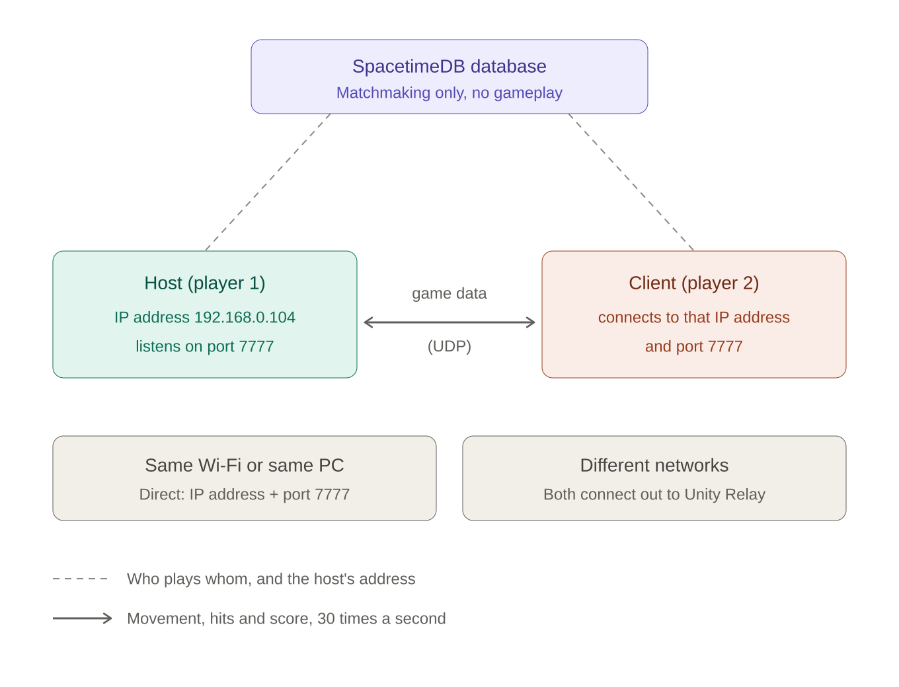

# How the networking in Season Rush works (notes for the presentation)

## 1. The one-minute version

* Season Rush is a **2-player online game**. One player is the **host**: their game is both a player and the **server**. The other
  player is the **client** and connects to the host over the network.
* To connect, the client needs two things: the host's **IP address** (which computer) and a **port** (which program on that computer).
  In my game the port is always **7777**.
* After they are connected, Unity's **Netcode for GameObjects** keeps both screens in sync: positions, health, score, enemies and
  the season timer travel over the connection about **30 times a second**.
* A **SpacetimeDB database** is only the "waiting room": it pairs two players who pressed PLAY and tells the guest the host's
  address. **No gameplay goes through the database.**

## 2. IP address and port in plain words

Think of a letter that must reach one person in a big apartment building:

| In the post | In networking | In my game |
| --- | --- | --- |
| The building's street address | **IP address** - identifies one computer on a network | `192.168.0.104` (the host's PC on the Wi-Fi) |
| The apartment door number | **Port** - identifies one program on that computer | `7777` (Season Rush) |
| The letter | A **packet** (a small chunk of data) | "Player 2 is at position (4.2, 6.1)" |

The packet is only delivered if **both** are right. If the port is wrong, the computer is found but no program is listening
there, so nothing happens.

The addresses you will see in the game:

| Address | Meaning |
| --- | --- |
| `127.0.0.1` | "This computer". Used when both game windows run on the **same PC**. The data never leaves the machine. |
| `192.168.x.x` or `10.x.x.x` | A **private** address inside one Wi-Fi / home network. Other devices on the same Wi-Fi can reach it. |
| `0.0.0.0` | What the **host listens on**: "accept connections arriving on any of this computer's network cards". |
| Port `7777` | The default port of Unity's networking. Any free port between 1024 and 65535 would work, as long as the host and the client use the **same** one. |

**Why can't a friend in another city type my `192.168...` address?** A private address only exists inside my home network.
My router hides it from the internet (NAT) and drops unknown incoming traffic. That is why the game has a second way to connect
(**Unity Relay**, section 5): both players connect *out* to a server in the middle, so nobody has to open ports on a router.

**UDP, not TCP.** Unity Transport sends the game data over **UDP**: fast and light, with no waiting for lost packets. That is right
for a real-time game, because a position from half a second ago is useless. Netcode adds reliability only where it is needed
(for example "this enemy died").

## 3. Who is the server? (host model)

There is **no dedicated server**. When a player presses HOST, their game starts as **server + player at once** (Netcode calls
this a *Host*). The other player starts as a *Client*.

* The host **listens** on its IP and port 7777.
* The client **connects** to `host-IP : 7777`.
* The host **approves** the connection (`ConnectionMenu.ApproveConnection`). The match is **limited to 2 players**: a third
  player is refused with "The match is full (2 players maximum)". The approval also decides each warrior's start spot (player 1 blue on
  the left, player 2 red on the right).
* When the host quits, the match ends for the client ("Disconnected from the host").

## 4. Local network: HOST A MATCH / JOIN MATCH

Menu: **LOCAL NETWORK**.

1. Player 1 presses **HOST A MATCH**. The game starts a Netcode host on port 7777 and waits. The lobby shows
   *"Tell your friend to join this address: 192.168.0.104 port 7777"* (the PC's IP addresses, found by the game).
2. Player 2 presses **LOCAL NETWORK**, types that address in **Host IP** and `7777` in **Port**, and presses **JOIN MATCH**.
3. The host approves, spawns player 2's warrior, and as soon as 2 players are connected the 3-2-1 countdown starts.

Two windows on one PC use `127.0.0.1` (the default in the box).

## 5. PLAY: random opponent online

1. Both players press **PLAY**. Each game talks to the **SpacetimeDB** database and joins its **queue**.
2. The database **pairs** the first two players in the queue. The one who waited longest becomes the **host**. It also creates a
   short **match code**.
3. The host starts the Netcode host. Then it publishes **how to reach it** into the pairing row of the database:
   * on the **same network**: its own private IP and port, e.g. `192.168.0.104:7777` (direct connection), or
   * when the project is linked to Unity Cloud: the word `relay` (**Unity Relay**). Both players join one relay session named by
     the match code. The relay server forwards the traffic, so no IP address or port is typed and no router setting is needed.
4. The guest reads the address from the database and connects (direct: to `ip:port`; relay: to the session).
5. The match is played over Netcode. At the end the host sends the **result** to the database, which updates both players' stats and the
   leaderboard.

So: **the database decides who plays whom and passes the address. The game data goes straight between the two players (or through
the Relay).**

## 6. What travels over the connection

| Netcode feature | What it does in my game | Example |
| --- | --- | --- |
| **NetworkTransform** | copies an object's position to the other player | where each warrior stands; where each enemy is |
| **NetworkVariable** | a value the **server** owns and every client receives automatically when it changes | health, score, kills, deaths, "is dead", match phase, season number, season timer |
| **ServerRpc** | "client asks the server to do something" | "I swung my sword in this direction" |
| **ClientRpc** | "server tells the clients about an event" | hit effect, knock-back, season banner, score pop-up, final result |
| **Spawn / despawn** | the server creates or removes a networked object for everyone | enemies appear and are removed when killed or when the season changes |

The game runs at **30 network ticks per second** (`NetworkConfig.TickRate = 30`); positions are smoothed (interpolated) so
movement looks fluid between ticks.

## 7. Who decides what (server authority)

* **The host (server) decides** everything that matters for fairness: damage, kills, score, respawn after 5 seconds, the season timer,
  who wins. Clients only send "I swung" and their own movement.
* **Each player owns their own movement** (owner authority): it feels instant for the player, because the game does not wait for the
  server's answer before moving the warrior.
* This is a *trade-off*: a modified client could cheat with its own movement, and the host's PC is trusted with the match result.
  That is acceptable for a class project; a commercial game would use a dedicated server and more checks.

## 8. Live demo (2 minutes)

1. Press **Play** in Unity, click **LOCAL NETWORK > HOST A MATCH**. Point at the lobby text: "this is my IP address and port".
2. Start `Builds/Windows/SeasonRush.exe` (build it first with *Season Rush > Build Windows Player*). Click **LOCAL NETWORK**, keep
   `127.0.0.1` and `7777`, click **JOIN MATCH**. The countdown starts on both screens.
3. Walk around and attack: show that both windows show the same positions, the same score and the same season timer.
4. (Optional) Close the client and join again with a **wrong port** (for example 7778): it cannot connect, because no program listens
   there. This shows what the port is for.

## 9. Questions you may get

| Question | Short answer |
| --- | --- |
| What is `127.0.0.1`? | The computer itself ("localhost"). Two windows on one PC talk to each other through it. |
| Why 7777? | It is Unity Transport's default port. Only the two sides must agree, and it must be free. Players can type another one on the LOCAL NETWORK screen. |
| Why does it only work on the same Wi-Fi without Relay? | A `192.168` address is private. Different networks need either **port forwarding** on the router or a **relay** server; I use the relay (Unity Relay). |
| Why UDP? | Faster and lighter for real-time data; old data is useless, so waiting for re-sends would only add lag. Netcode adds reliability only for important messages. |
| Where is the server? | On the **host's PC**. Whoever presses HOST (or waits the longest in the queue) is the server. |
| Why a database if it is not the server? | It is the **waiting room and address book**: queue, pairing, names, stats, leaderboard, match history. |
| What if someone loses connection? | The client sees "Disconnected from the host" and returns to the menu; if the host leaves, the match ends. |
| Can a third player join? | No. Connection approval allows exactly 2 players. |
| Can players cheat? | Damage, score and the timer are decided on the host, so a client cannot fake them. Movement is trusted from each player (trade-off for responsiveness). |

## 10. What is tested and what is not (be honest in the presentation)

* **Tested:** host + client on one PC (`127.0.0.1` and the PC's LAN address `192.168.0.104:7777`), the full 3-season match over
  Netcode, the database queue and pairing with two game windows (against a local SpacetimeDB server), automatic results and stats.
* **Not tested yet:** two players on **different networks** through Unity Relay (needs the Unity Cloud project link), the real
  SpacetimeDB **Maincloud** server, and a real phone.

## 11. Where it is in the code

| What | File |
| --- | --- |
| Port 7777, default address `127.0.0.1`, 2 players maximum | `Assets/Scripts/Core/GameTypes.cs` (`GameConfig`) |
| Host listens on `0.0.0.0:port`, client connects to `ip:port`, connection approval (2 players) | `Assets/Scripts/Network/ConnectionMenu.cs` |
| The lobby text with the PC's IP addresses | `Assets/Scripts/UI/GameHud.cs` (`LocalAddresses`) |
| PLAY: queue, pairing, host publishes its address, guest connects, Relay | `Assets/Scripts/Network/OnlineMatchmaker.cs` |
| Database tables and reducers (queue, pairing, stats) | `spacetimedb/Lib.cs`, `Assets/Scripts/Online/SpacetimeManager.cs` |
| NetworkManager, transport and tick rate set-up | `Assets/Editor/SeasonRushSetup.cs` |
| NetworkVariables and RPCs: players, enemies, match | `PlayerStats.cs`, `PlayerController.cs`, `PlayerCombat.cs`, `Enemy.cs`, `MatchManager.cs` |

More detail: `Week2_and_Week3_Multiplayer_Implementation.md`, `Online_Matchmaking_Setup.md`, `SpacetimeDB_Setup.md`.
