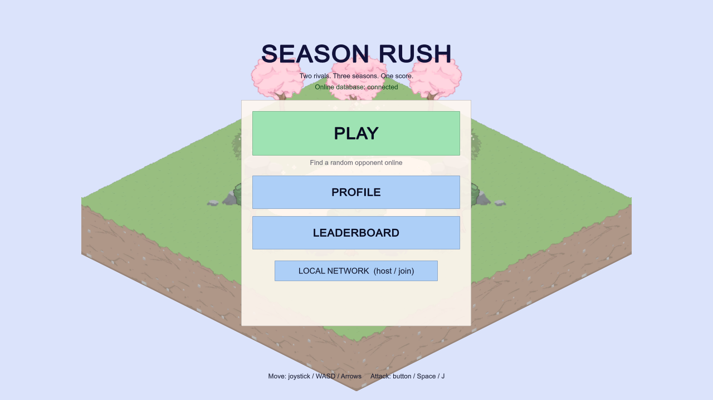
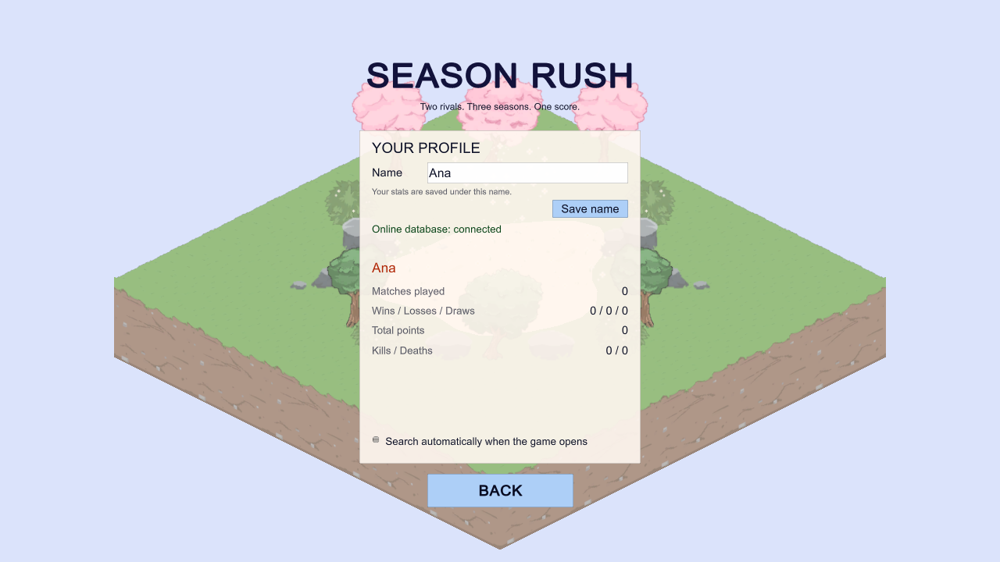
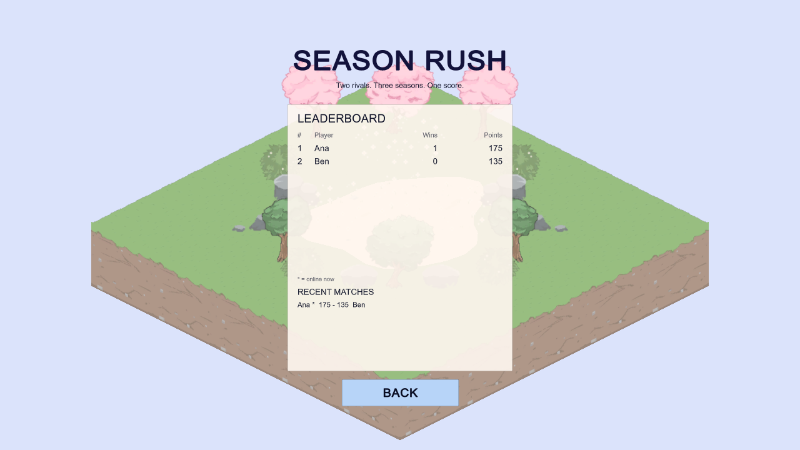
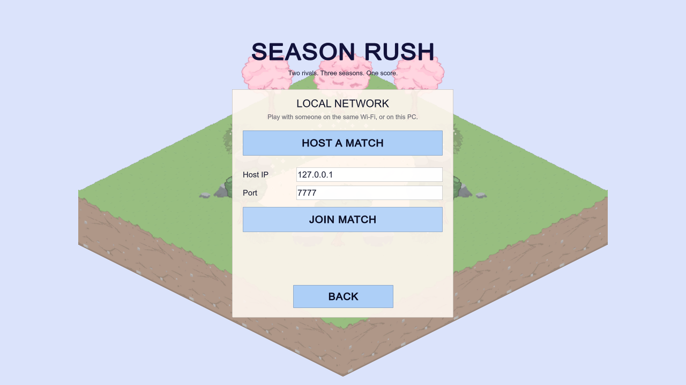
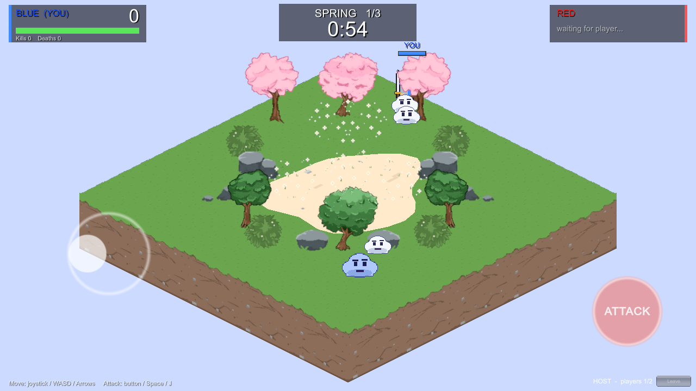
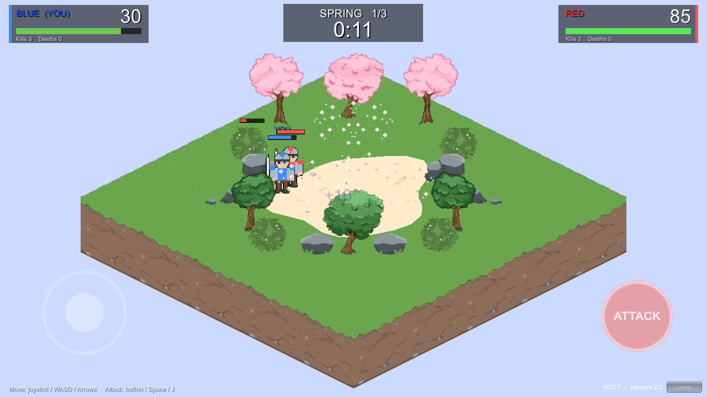
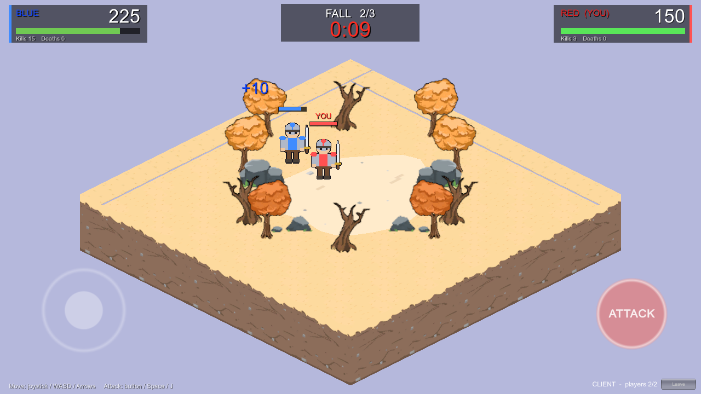
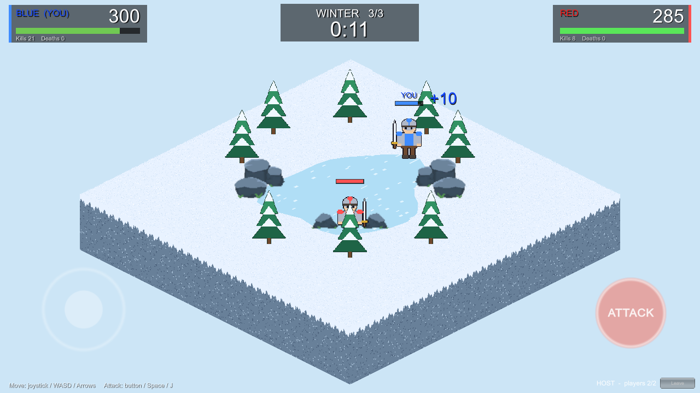

# Season Rush - Week 2 and Week 3: Multiplayer Prototype and Core Gameplay

**Week 2 milestone (3 Nov): core networking.  Week 3 milestone (10 Nov): core gameplay and network synchronization.**
Netcode for GameObjects 2.13.3, Unity Transport, Unity 6000.3.22f1. Two players: one Host, one Client.

How to run it is in the [README](../README.md). The short version: press Play in the Editor and click
**HOST A MATCH**, run the built `SeasonRush.exe` and click **JOIN MATCH**.

---

## Week 2 - Multiplayer prototype

| Requirement from the timeline | Status | How it is done | Where |
| --- | --- | --- | --- |
| Host and Client can connect successfully | Done | `NetworkManager` + `UnityTransport` in the scene. **Host** calls `StartHost()` (listens on `0.0.0.0:7777`), **Join** calls `StartClient()` with the host's IP and port. Connection approval accepts at most 2 players and tells a third player "The match is full". | `Scripts/Network/ConnectionMenu.cs`, scene object `NetworkManager` |
| Players spawn correctly in the game | Done | The `Player` prefab is the NetworkManager *Player Prefab*, so Netcode creates one per connection. The approval callback gives each one its starting position: blue on the left corner, red on the right corner. | `ConnectionMenu.ApproveConnection`, `Prefabs/Player.prefab` |
| Player movement is synchronized | Done | Each player **owns** their warrior and moves their own `Rigidbody2D` from the keyboard. A `NetworkTransform` (authority mode **Owner**, interpolation on, only X/Y synced) replicates the position. | `Scripts/Player/PlayerController.cs`, `Player.prefab` |
| `NetworkManager`, `NetworkObject`, ownership and `NetworkTransform` configured correctly | Done | see the checklist below | `Player.prefab`, `Enemy.prefab`, scene |
| Basic gameplay environment and first map underway | Done (ahead of schedule) | Spring is a full isometric floating island with obstacles, spawn points and enemies. Fall and Winter exist too. | `Scripts/Map`, `Assets/Data/SpringTheme.asset` |

### Netcode configuration checklist

| Item | Setting | Why |
| --- | --- | --- |
| `NetworkManager` | Player Prefab = `Player`; Network Prefabs List = `SeasonRushNetworkPrefabs` (Enemy, MatchManager); Connection Approval **on**; tick rate 30; run in background **on** | Spawns players; lets the server create enemies; caps the match at 2 players; two windows on one PC keep running |
| Transport | `UnityTransport`, 127.0.0.1:7777 default, host listens on 0.0.0.0 | Works on one PC and over a LAN |
| `NetworkObject` on `Player`, `Enemy`, `MatchManager` | One per prefab | Required for anything that is synchronized |
| Ownership | Player: owned by the connecting client. Enemy and MatchManager: owned by the server | Owner moves the player; server controls everything else |
| `NetworkTransform` on `Player` | Authority = **Owner**, sync position X/Y, no rotation/scale, interpolate | The owner's own input has no network lag; others see a smooth copy |
| `NetworkTransform` on `Enemy` | Authority = **Server**, sync position X/Y, interpolate | The server runs the AI, so it decides positions |
| `NetworkRigidbody2D` | On Player and Enemy | Remote copies become kinematic and just follow the network position |
| Physics layers | Player, Enemy, Obstacle. Players and enemies never collide with each other, only with obstacles and the arena walls | Fighting is handled with server-side distance checks |

---

## Week 3 - Core gameplay and network synchronization

| Requirement from the timeline | Status | How it is done | Where |
| --- | --- | --- | --- |
| Main gameplay mechanics are functional in multiplayer | Done | Warrior melee attack, three monster types per season, score for kills, 5 second respawn penalty, three 2 minute seasons, win condition. | `PlayerCombat.cs`, `Enemy.cs`, `MatchManager.cs` |
| `NetworkVariable`s synchronize important game state (health, score, team status) | Done | Player: `Health`, `Score`, `Kills`, `Deaths`, `IsDead`, `RespawnAt`, `Slot` (colour/team). Match: `Phase`, `SeasonIndex`, `PhaseEndTime`, `WinnerSlot`. Enemy: `TypeId`, `Health`. All are written by the server only. | `PlayerStats.cs`, `MatchManager.cs`, `Enemy.cs` |
| RPCs are used for appropriate actions or events | Done | See the RPC table below. | |
| Network spawning and despawning work where needed | Done | The server spawns the `MatchManager` and every enemy (`Spawn()`), and despawns enemies when they die and when a season ends (`Despawn(true)`). Players are spawned/despawned by Netcode on connect/disconnect. | `ConnectionMenu.OnServerStarted`, `MatchManager.TickEnemySpawner`, `Enemy.ServerTakeDamage` |
| First map playable, second map has a visible layout or working prototype | Done - first map playable, **second and third map also playable** | The match switches map automatically at each season change. Fall uses the new Fall art; Winter uses placeholder art. | `MapManager.cs`, `Assets/Data/*Theme.asset` |
| Players can interact with one another through the core mechanics | Done | Both players fight for the **same** enemy pool, so they compete for kills (the killer gets the points). A hit on the rival shoves them away (no damage). A death gives the rival 5 seconds of free scoring. Live scores are always visible. | `PlayerCombat.AttackServerRpc`, `PlayerStats.ServerTakeDamage` |

### RPCs

| RPC | Direction | When | Why an RPC |
| --- | --- | --- | --- |
| `AttackServerRpc(direction)` | Owner -> Server | Player presses attack | Only the server may decide hits, damage and points |
| `AttackFxClientRpc(direction)` | Server -> all | After a valid attack | Show the slash on the other player's screen |
| `HitClientRpc()` (player and enemy) | Server -> all | Something takes damage | Red flash feedback |
| `TeleportClientRpc(position)` | Server -> owner only | Respawn, new season, match start | The owner controls the position, so the owner must do the move |
| `KnockbackClientRpc(direction)` | Server -> owner only | Rival hit you | Push applied by the player who owns the body |
| `SeasonChangedClientRpc(season)` | Server -> all | New season starts | Big season banner |
| `ScorePopupClientRpc(position, points, slot)` | Server -> all | Kill | Floating "+25" in the killer's colour |
| `MatchFinishedClientRpc(winner)` | Server -> all | Timer of Winter ends | Result screen |

### Rules (from the concept document) and how they are enforced

| Rule | Implementation |
| --- | --- |
| 6 minute match = 3 seasons x 2 minutes | `MatchManager` state machine: Lobby -> Countdown -> Playing x3 -> Finished. `GameConfig.SeasonSeconds = 120` |
| Environment and enemies change when the timer ends | `SeasonIndex` NetworkVariable changes; every peer swaps the map and the sky. The server despawns all enemies and spawns the new season's monsters. |
| Score only from killing enemies, three difficulty tiers | Weak 10 / Medium 25 / Strong 60-65 points, assigned on the server when an enemy dies |
| Both players have the same warrior, only the colour differs | One `Player` prefab; a white tunic layer is tinted by the `Slot` NetworkVariable |
| Death = 5 second respawn, rival scores meanwhile | `PlayerStats.ServerTakeDamage` sets `IsDead` and `RespawnAt`; `Update` respawns on the server |
| Win condition, tie-break | Higher score wins; tie -> fewer deaths; otherwise draw (sudden death not built) |
| Camera does not follow anyone | `MapManager.FrameCamera` keeps the whole island in view |

---

## Extra features added after Week 3

| Feature | What it does | Where |
| --- | --- | --- |
| **On-screen joystick + ATTACK button** | A floating joystick (press and drag anywhere on the left) and a hold-to-attack button on the right. Works with fingers (multi-touch) or a mouse, together with the keyboard. | `Scripts/UI/VirtualControls.cs` |
| **Random online matchmaking** | Press **PLAY** in the menu: sign in anonymously, quick-join any open game or create one, Relay carries the traffic, and the match starts when two players are in. Needs a one-time Unity Cloud setup. | `Scripts/Network/OnlineMatchmaker.cs`, [`Online_Matchmaking_Setup.md`](Online_Matchmaking_Setup.md) |

| **SpacetimeDB database** | Player names and lifetime stats, a leaderboard, match history, and the **matchmaking queue** that pairs two players (the database decides who hosts, then the two players connect their Netcode game). | `spacetimedb/Lib.cs` (C#), `Scripts/Online/SpacetimeManager.cs`, [`SpacetimeDB_Setup.md`](SpacetimeDB_Setup.md) |

The start menu has three big buttons - **PLAY** (random online match), **PROFILE** and **LEADERBOARD** - and a small
**LOCAL NETWORK** button for host / join. Each button opens its own screen with a BACK button.











---

## How we tested it

An automated check runs a real **Host** and a real **Client** (two copies of the built game, connected
over `127.0.0.1`) and compares what each one sees. Start the game with `-autotest` (see
`Scripts/Debug/AutomatedTestDriver.cs`); without that flag nothing automatic happens, warriors are
controlled by the player, and the game never starts a bot.

All results below are from the **final build**.

### Test 1 - Host + Client, full match

Seasons shortened to 20 s. Full logs: [`test-evidence/host_client_match_log.txt`](test-evidence/host_client_match_log.txt).

| Check | Result |
| --- | --- |
| Client connects to the host | Pass - host log: `Client connected: id=1 (players=2)`, client log: `Client connected: id=1` |
| Both players spawn on opposite corners with different colours | Pass - both screenshots show a blue and a red warrior; the host log shows blue spawning at (1.8, 10.2) |
| Movement is synchronized | Pass - each peer's log shows the other player's position changing as they walk; the final positions match on both: blue (6.05, 6.93), red (4.11, 4.11) |
| Match phases and seasons synchronized | Pass - both logs go Countdown -> Playing season 0 -> 1 -> 2 -> Finished |
| Enemies spawn on the server and appear on the client | Pass - client log shows enemies alive during play |
| Score, kills, health are NetworkVariables | Pass - final state identical on both peers: blue 420 pts / 26 kills / 0 deaths, red 285 pts / 8 kills / 0 deaths |
| Result screen | Pass - "YOU WIN!" on the winner's screen ([`images/match_result.png`](images/match_result.png)) |
| Errors or warnings in either log | None |

Earlier runs of the same test (before two small balance changes) also covered the death rule: a player's
health reached 0, `dead=True` was reported on both peers for about 5 seconds, then they came back at full health
near their starting corner.

### Test 2 - the player controls the warrior with the keyboard (no bot)

A solo host driven only by key presses delivered through Unity's Input System (`Keyboard.current`, exactly what
the game reads). Log: [`test-evidence/keyboard_control_log.txt`](test-evidence/keyboard_control_log.txt).

| Keys | Position change on the arena plane | Meaning |
| --- | --- | --- |
| `D` held 2 s | (1.8, 10.2) -> (5.3, 6.7) -> (9.1, 3.1) | right on screen |
| `W` held 2 s | -> (11.6, 6.2) -> (11.6, 8.5); stops at the arena wall | up on screen |
| `A` held 2 s | -> (8.0, 11.6) -> (5.8, 11.6) | left on screen |
| `S` held 2 s | -> (3.2, 9.0) | down on screen |
| `Space` taps | `attack input on owner`, then `server received swing` | the attack reaches the server through the RPC |

### Test 3 - the on-screen joystick and ATTACK button

A simulated pointer presses on the left side and drags, then holds the ATTACK button (the same code path a finger or
a mouse uses). Log: [`test-evidence/joystick_control_log.txt`](test-evidence/joystick_control_log.txt). Each log line
shows the previous frame's value, so read the value one line later.

| Pointer action | Joystick value | Result |
| --- | --- | --- |
| drag right | `Move = (1.00, 0.00)` | warrior walks (1.8, 10.2) -> (4.8, 7.2) -> (8.6, 3.5): right on screen |
| drag up | `Move = (0.00, 1.00)` | walks to (11.6, 7.9): up on screen |
| small push left | `Move = (-0.38, 0.00)` | analog: slower walk, to (10.2, 9.8) |
| hold ATTACK button | `attackHeld = True` | `attack input on owner`, then `server received swing` |

### Test 4 - PLAY before the project is linked to Unity Cloud

Pressing PLAY (or starting the game with `-findmatch`) starts a search; because the project is not linked yet it
stops with the message "Online play is not set up yet..." and the menu stays usable (HOST / JOIN). No exception
in the log. Log: [`test-evidence/online_not_linked_log.txt`](test-evidence/online_not_linked_log.txt).

### Test 5 - random matchmaking and stats through SpacetimeDB (two windows)

Two copies of the game on one PC, each started with `-findmatch` and a different name, both talking to a **local
SpacetimeDB server** that runs the shipped C# module (`spacetimedb/dist/seasonrush.wasm`). The windows were started 3 seconds
apart and both searched automatically. Logs: [`test-evidence/database_matchmaking_log.txt`](test-evidence/database_matchmaking_log.txt).
Database contents afterwards: [`test-evidence/database_contents.txt`](test-evidence/database_contents.txt).

| Check | Result |
| --- | --- |
| Both connect to the database as separate players | Pass - two different identities, `[DB] ready` in both logs |
| The queue pairs them and picks who hosts | Pass - both logs show the same match code `CGNHVRZW`; the player who waited longest is the host |
| The pairing carries the real player names | Pass - `paired with Ben` / `paired with Ana` (a bug where default names appeared was found and fixed during testing) |
| The guest gets the host's address from the database and connects | Pass - `hosting directly at 192.168.0.104:7777` / `connecting directly to 192.168.0.104:7777`, then `Client connected ... players=2` |
| A full 3-season match is played over Netcode as before | Pass - phases Countdown -> Spring -> Fall -> Winter -> Finished |
| The host stores the result | Pass - `[DB] reported match CGNHVRZW: blue 175 vs red 135, winner slot 0` |
| Lifetime stats are updated for both players | Pass - Ana 1 win, 175 points, 13 kills; Ben 1 loss, 135 points, 5 kills |
| Match history, pairing marked as reported, queue emptied | Pass - 1 `match_result` row, `reported = true`, `queue_entry` empty |
| The result screen shows the player's record | Pass - "Your record: 1 W - 0 L - 0 D, 175 points in 1 match" ([`images/db_result.png`](images/db_result.png)) |
| Menu shows profile, leaderboard and recent matches from the database | Pass ([`images/menu_profile.png`](images/menu_profile.png), [`images/menu_leaderboard.png`](images/menu_leaderboard.png), [`images/db_searching.png`](images/db_searching.png)) |
| Errors in either log | None |

The database module was also tested on its own from the command line: a bad name (`bad@name!`) is rejected with a
clear message, and joining and leaving the queue work.

During the test runs a real mouse clicked the on-screen REMATCH button on a visible test window (the log shows the same
mouse position, window focused). Test runs ignore that button, so it did not start a second match.

### What these tests do **not** prove

* **The real SpacetimeDB Maincloud** - the test used a local server on the same PC. Publishing to Maincloud needs
  your own login (`tools/Publish-SpacetimeDB.ps1`).
* **Players on different networks** - the two windows connected directly over this PC's network address. Across
  different home networks the game needs Unity Relay, which needs the Unity Cloud project (below).
* **Online matchmaking against the real Unity services** - it needs your Unity Cloud project (Relay + Lobby). Only the
  "not set up" path is tested. See [`Online_Matchmaking_Setup.md`](Online_Matchmaking_Setup.md).
* **Real touch screens** - the joystick is tested with a simulated mouse-style pointer.
* **The physical keyboard and two separate PCs** - key presses were injected through the Input System, and both
  game windows ran on one PC. A hands-on session with two people is still the final check.

### Screenshots

| Spring | Fall | Winter |
| --- | --- | --- |
|  |  |  |

### How to repeat the tests

```bash
# build once: Unity menu  Season Rush > Build Windows Player
SeasonRush.exe -host   -autotest -bot -seasonSeconds 20 -quitAfter 78 -tag host   -outDir TestOutput -logFile host.log
SeasonRush.exe -client -autotest -bot -ip 127.0.0.1       -quitAfter 78 -tag client -outDir TestOutput -logFile client.log
# keyboard path, solo:
SeasonRush.exe -host -autotest -solo -simkeys -quitAfter 30 -outDir TestOutput -logFile keys.log
# on-screen joystick, solo:
SeasonRush.exe -host -autotest -solo -simjoystick -quitAfter 24 -outDir TestOutput -logFile stick.log
# online search without a linked project:
SeasonRush.exe -autotest -findmatch -quitAfter 9 -outDir TestOutput -logFile find.log
# SpacetimeDB matchmaking, two windows against a local server (spacetime start; spacetime publish --server local ...):
SeasonRush.exe -autotest -bot -findmatch -direct -name Ana -sdbUri http://127.0.0.1:3000 -sdbDb seasonrush-local -seasonSeconds 12 -quitAfter 72 -outDir TestOutput -logFile ana.log
SeasonRush.exe -autotest -bot -findmatch -direct -name Ben -sdbUri http://127.0.0.1:3000 -sdbDb seasonrush-local -seasonSeconds 12 -quitAfter 72 -outDir TestOutput -logFile ben.log
```

## Known gaps (planned for Week 4)

* Placeholder art for the warrior, the monsters and the Winter map; no animations yet.
* No sound. HUD and menus use Unity's immediate-mode GUI and are functional rather than polished.
* Colour is assigned automatically (first player blue, second red) instead of a pick screen.
* Sudden death for tied matches; ice "slipperiness" in Winter.
* Enemies have no pathfinding; they chase in a straight line and side-step when blocked.
* The host sees the game with zero network delay, so in an online match the host has a very small advantage when
  racing for the same enemy.
